Install Linux Mint
==================

The live session
----------------

When you boot the computer from the USB stick (or DVD), Linux Mint starts a ``live session``. It logs you in automatically as a user called ``mint`` and shows you a desktop with the installer on it:

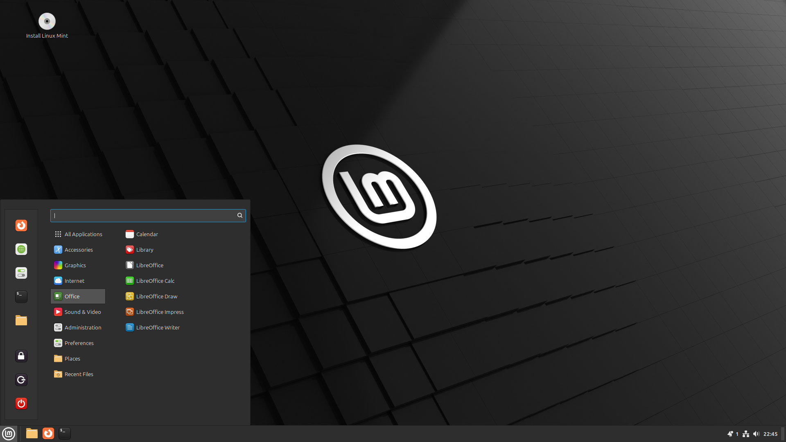

    The Linux Mint live session

The ``live session`` is similar to a normal session (i.e. to Linux Mint once it is permanently installed on the computer), but with the following exceptions:

* The Live session is slower (it is loaded from a USB stick or DVD as opposed to a SSD or HDD).
* Changes you make in the live session are not permanent. They are not written to the USB stick (or DVD) and they do not impact the system installed by the installer.
* Some applications work differently (or not at all) in the live session (Timeshift, Flatpak, Update Manager, Welcome Screen..etc.).

.. hint::
    The username for the live session is ``mint``. If asked for a password, press :kbd:`Enter`.

Installing Linux Mint on the computer
-------------------------------------

To permanently install Linux Mint on your computer:

1. Double-click :guilabel:`Install Linux Mint`.

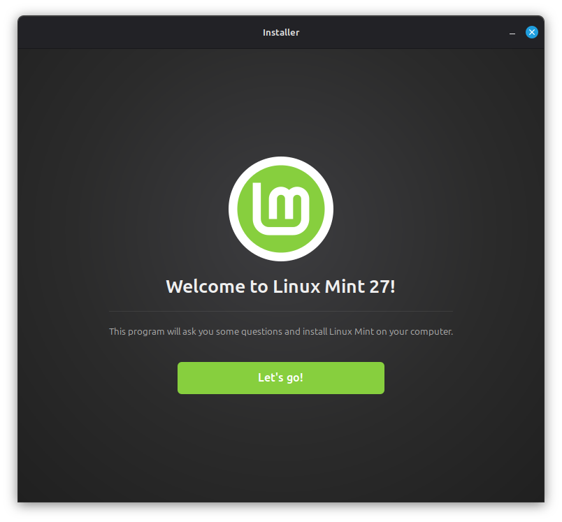

2. Select your language.

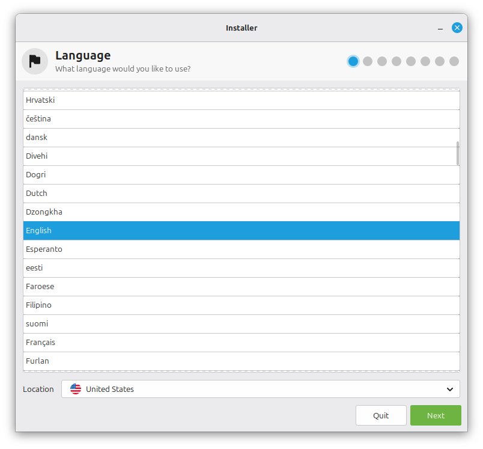

3. Select the timezone that you live in.

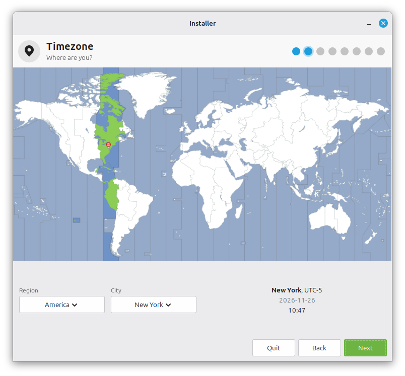

4. Select your keyboard layout

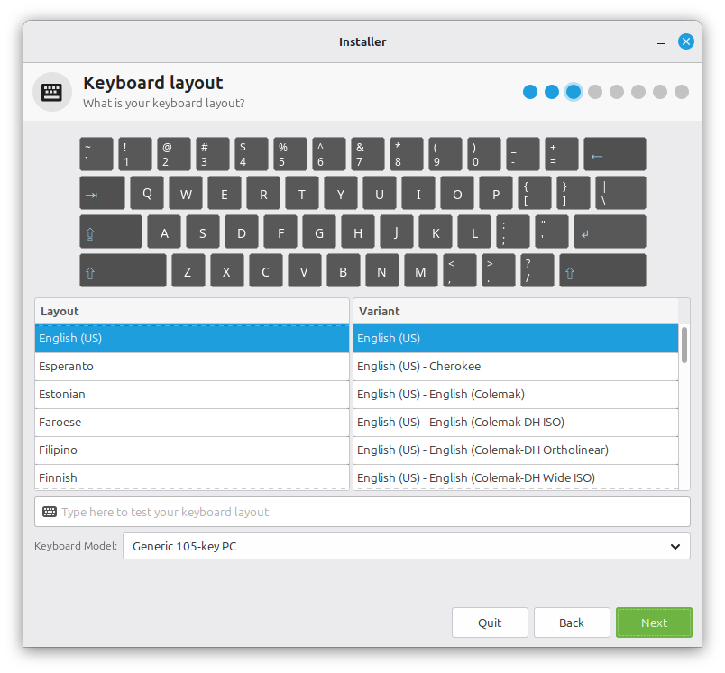

5. Enter your user details

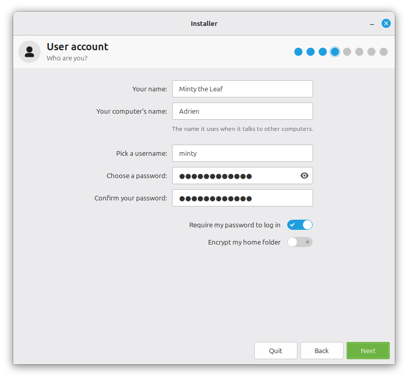

Your ``name`` can be your real name, but it doesn't have to be. It is only used locally, in the screensaver and on the login screen.

Your ``username`` is what you log in as, and your ``hostname`` is the name of your computer on the network.

To prevent bugs only use lowercase characters, with no punctuation or accentuation.

To protect your personal data against local attacks (people around you, or in case your computer gets stolen), tick :guilabel:`Encrypt my home folder`.

Choose a strong password.

6. Choose an installation type.

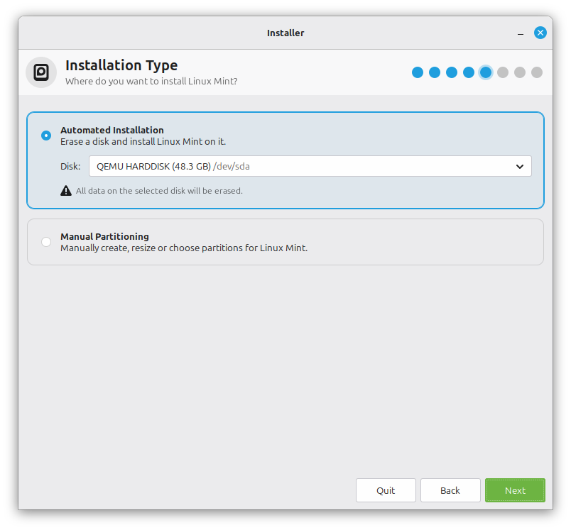

**If Linux Mint is the only operating system you want to run on this computer and all data can be lost on the hard drive**, choose :guilabel:`Automated Installation`.

**If another operating system is present on the computer and only has 1 hard drive**, Then choose :guilabel:`Manual Partitioning`, and then :guilabel:`Launch GParted`.

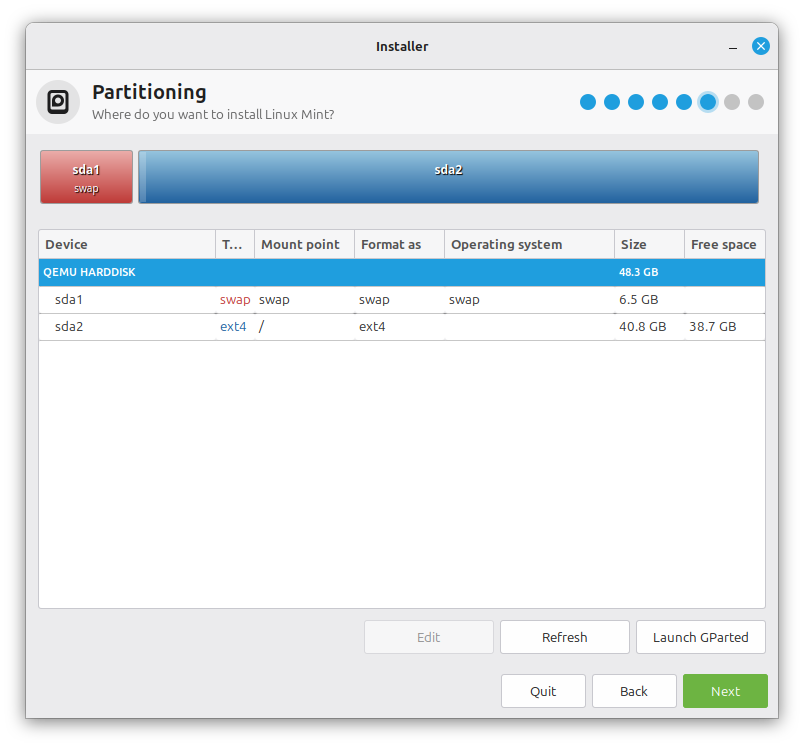

In GParted, Right click on a partition to select resize, or right click on an unalocated partition to create a new file system in it.

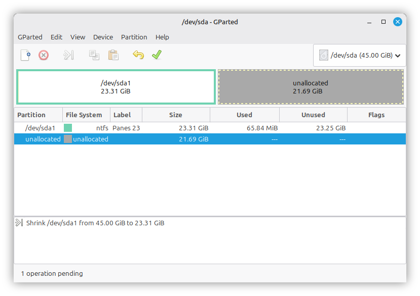

You can size the partition by dragging the sliders around. For faster times, its recomended that you use the slider on the right side, as files would have to be moved if there are files in the partition.

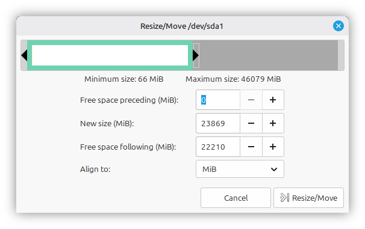

The Linux Mint operating system (without additional software or personal data) takes roughly 20GB, so give this partition a decent size (100GB or more).

Once you are done resizing the partitions, click on the green checkmark to close and write to your disk.

Next, Right-Click on the partition that you want to make the home for Linux Mint and click on :guilabel:`Assign to /`.

Linux Mint requires one partition to be mounted on the root ``/`` directory.

``ext4`` is recommended. It is the most popular Linux filesystem.

Click :guilabel:`Next`.

7. Select any aditional options for installation

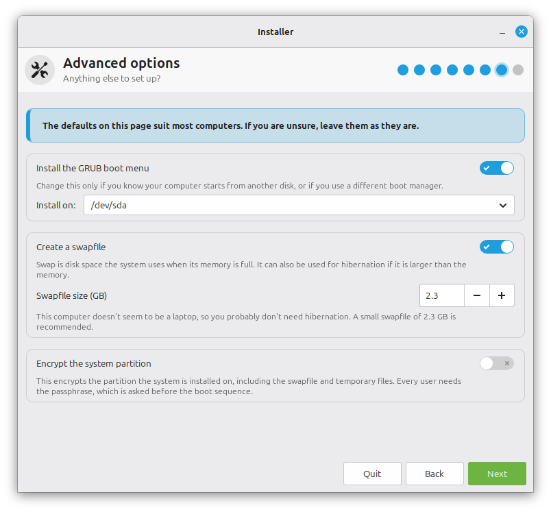

.. warning::
    :guilabel:`Encrypt the system partition` refers to full disk encryption. At this stage of the installation your keyboard layout wasn't yet selected so it is set to en_US. If you decide to use this option, keep this in mind when entering a password. Note that there are issues with this option and some NVIDIA drivers. If you are new to Linux use home directory encryption instead (you can select it later during the installation).

8. Confirm that your choices are correct before hitting :guilabel:`Install`

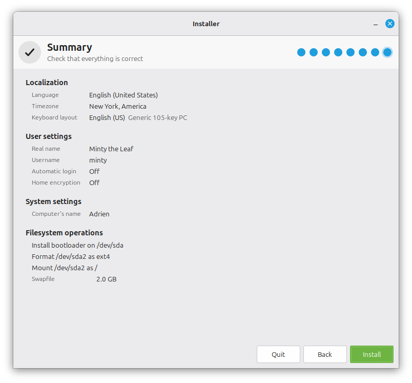

9. Enjoy the slideshow while Linux Mint is installed on your computer.

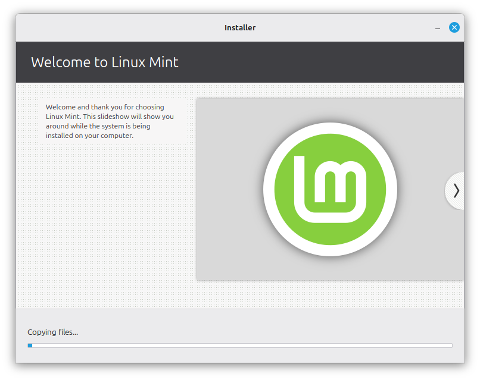

When the installation is finished, click :guilabel:`Restart Now`.

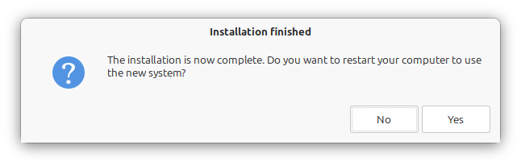

The computer will then start to shut down and ask you to remove the USB disk (or DVD). Upon reboot, your computer should show you a boot menu or start your newly installed Linux Mint operating system.
